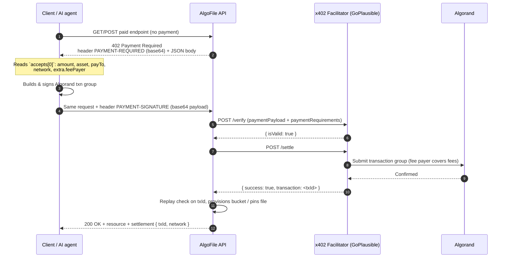

<p align="center">
  
</p>

<h1 align="center">AlgoFile Backend</h1>

<p align="center">
  Decentralized IPFS storage on Algorand, paid per request over HTTP with the <strong>x402</strong> protocol.
</p>

<p align="center">
  <a href="https://algofile.io">Website</a> ·
  <a href="https://api.algofile.io">Public API</a> ·
  <a href="#the-x402-protocol-in-algofile">x402 implementation</a> ·
  <a href="#getting-started">Getting started</a>
</p>

---

## About

AlgoFile is a storage network that pins files to IPFS (through [Filebase](https://filebase.com)) and charges for storage in **USDC or ALGO on Algorand**. Payment happens inside the HTTP request itself: a client — a browser, a script or an autonomous AI agent — calls an endpoint, receives `402 Payment Required` with machine-readable payment instructions, signs an Algorand transaction and retries. No account, no API key and no checkout page is needed.

This repository is the NestJS backend that powers [algofile.io](https://algofile.io).

### Origin of the project

AlgoFile was created as part of the **Algorand initiative, together with [GoPlausible](https://goplausible.xyz), to bring the x402 protocol to the Algorand ecosystem**. GoPlausible operates the Algorand x402 **facilitator** used by this project (`https://facilitator.goplausible.xyz`), which verifies and settles payments on-chain and indexes paid resources in the **x402 Bazaar** discovery catalog. AlgoFile is a real-world x402 resource server built on top of that infrastructure, and is published as open source so other builders can use it as a reference implementation.

---

## The x402 protocol in AlgoFile

### What is x402?

[x402](https://x402.org) revives the long-unused HTTP status code **`402 Payment Required`** as an open payment standard for the web. A server describes *what* it wants to be paid (amount, asset, network, receiver) in a 402 response; the client attaches a signed payment to the next request; a **facilitator** verifies and settles it on-chain; the server delivers the resource.

Because everything is plain HTTP + JSON, x402 is well suited to **machine-to-machine payments**: AI agents can discover a paid API, understand its price and pay for it without human intervention.

AlgoFile implements **x402 version 2** with the **`exact` scheme on Algorand (AVM)**.

### Roles

| Role | Who | Responsibility |
|---|---|---|
| **Client** | Browser dApp, CLI, AI agent | Calls the API, signs the Algorand payment, retries the request |
| **Resource server** | This backend | Issues 402 challenges, forwards payments to the facilitator, delivers the resource |
| **Facilitator** | GoPlausible (`FACILITATOR_URL`) | Verifies the signed transaction group, submits it to Algorand, pays network fees (gasless) and catalogs the resource in the Bazaar |
| **Algorand** | Testnet / Mainnet | Final settlement of the USDC (ASA) or ALGO transfer |

### End-to-end flow



### 1. The 402 challenge

When a paid endpoint is called without a payment, [`X402Service.send402Response`](src/x402/x402.service.ts) responds with status `402` and:

- the header **`PAYMENT-REQUIRED`** (also `payment-required`) containing the challenge as **base64-encoded JSON**;
- the header `WWW-Authenticate: x402 <base64>` for clients that look there;
- the **same JSON in the response body**, for easy debugging.

Example (`GET /api/v3/x402/bazaar/storage-info` on testnet):

```json
{
  "x402Version": 2,
  "error": "Payment required",
  "resource": {
    "url": "https://api.algofile.io/api/v3/x402/bazaar/storage-info",
    "description": "AlgoFile Integrated IPFS Storage Network & x402 Micro-payment Protocol",
    "mimeType": "application/json",
    "serviceName": "AlgoFile Storage",
    "iconUrl": "https://algofile.io/logo_mini.png"
  },
  "accepts": [
    {
      "scheme": "exact",
      "network": "algorand:SGO1GKSzyE7IEPItTxCByw9x8FmnrCDexi9/cOUJOiI=",
      "amount": "1000",
      "asset": "10458941",
      "payTo": "<ALGORAND_RECEIVER_WALLET>",
      "maxTimeoutSeconds": 300,
      "extra": {
        "asset": "10458941",
        "feePayer": "<facilitator fee payer address>",
        "tag": "x402-global-challenge"
      }
    }
  ],
  "extensions": {
    "bazaar": { "info": { "...": "..." }, "schema": { "...": "..." }, "discoverable": true },
    "merchant": { "info": { "name": "AlgoFile Storage", "website": "https://algofile.io" }, "schema": { "...": "..." } },
    "x402-merchant": { "...": "same as merchant" }
  }
}
```

Field meaning:

| Field | Meaning |
|---|---|
| `scheme` | Always `exact`: the client must pay exactly `amount`. |
| `network` | [CAIP-2](https://github.com/ChainAgnostic/CAIPs/blob/main/CAIPs/caip-2.md) id of the Algorand network (genesis hash). |
| `asset` | Algorand Standard Asset id. `"0"` means native ALGO. |
| `amount` | Amount in the asset's **base units** (USDC has 6 decimals: `1000` = $0.001, `1000000` = $1.00). |
| `payTo` | Algorand address that receives the payment. |
| `maxTimeoutSeconds` | How long the challenge is valid for. |
| `extra.feePayer` | Facilitator address that pays the transaction fees, so the client does not need ALGO for fees (**gasless**). |
| `extra.tag` | Campaign tag used by the facilitator dashboard. |

### 2. Networks and assets

Resolved by `getCaip2Network()` and `resolvePrice()` in [x402.service.ts](src/x402/x402.service.ts), driven by `ALGORAND_NETWORK`:

| `ALGORAND_NETWORK` | CAIP-2 network | USDC ASA id |
|---|---|---|
| `testnet` | `algorand:SGO1GKSzyE7IEPItTxCByw9x8FmnrCDexi9/cOUJOiI=` | `10458941` |
| `mainnet` | `algorand:wGHE2Pwdvd7S12BL5FaOP20EGYesN73ktiC1qzkkit8=` | `31566704` |

Prices can be declared as a dollar string (`"$0.01"` → `10000` base units of USDC) or as an explicit `{ asset, amount }` object. When a client prefers ALGO, the backend converts the USD price using the current ALGO price and sets `asset: "0"`.

### 3. The payment payload

The client retries the same request and attaches its payment. AlgoFile accepts the payload (base64 JSON or raw JSON) from, in order of preference:

1. header **`PAYMENT-SIGNATURE`** (x402 v2 standard)
2. headers `X-X402-Payment-Payload` / `X-Payment-Payload`
3. query param `x402Payload` / `paymentPayload`
4. JSON body field `x402Payload`

Expected shape for the Algorand `exact` scheme:

```json
{
  "x402Version": 2,
  "scheme": "exact",
  "network": "algorand:SGO1GKSzyE7IEPItTxCByw9x8FmnrCDexi9/cOUJOiI=",
  "payload": {
    "paymentGroup": ["<base64 msgpack txn 0>", "<base64 msgpack txn 1>"],
    "paymentIndex": 1
  }
}
```

- `paymentGroup` is an Algorand **atomic transaction group**, each element base64-encoded. It contains the client's transfer to `payTo` and, in gasless mode, a fee-payer transaction that the facilitator signs at settlement.
- `paymentIndex` points to the transaction that carries the actual payment. The backend decodes it with `algosdk` ([`extractSenderFromPayload`](src/x402/x402.service.ts)) to identify the payer's wallet, which is then used to create or link an AlgoFile account automatically — **the wallet is the identity**.

### 4. Verify and settle via the facilitator

[`X402Service.verifyAndSettle`](src/x402/x402.service.ts) sends the payment to the facilitator in two steps:

| Step | Request | Success condition |
|---|---|---|
| Verify | `POST {FACILITATOR_URL}/verify` | `isValid !== false` |
| Settle | `POST {FACILITATOR_URL}/settle` | `success === true` or a `transaction` id is returned |

Both calls carry the same body:

```jsonc
{
  "x402Version": 2,
  "resource": { "url": "...", "serviceName": "AlgoFile Storage", ... },
  "accepts": [ /* the server's requirements */ ],
  "extensions": { "bazaar": ..., "merchant": ... },
  "paymentPayload": { /* client payload + accepted requirements */ },
  "paymentRequirements": { /* server requirements, authoritative */ }
}
```

Important design choices:

- **The server's requirements are authoritative.** The resource URL, amount, asset and `payTo` always come from the server, never from the client payload, so a client cannot pay less or pay someone else.
- **Absolute resource URLs.** Paths are resolved against `BACKEND_URL` so the facilitator indexes a public, reachable HTTPS URL.
- **Gasless fees.** On startup the service calls `GET {FACILITATOR_URL}/supported` and reads `signers["algorand:*"][0]` as the fee payer (override with `FACILITATOR_FEE_PAYER`).
- **Replay protection.** After settlement the returned `txId` is checked against the `purchases` collection; a transaction id can only be redeemed once.

On failure the API returns `400 Bad Request` with the facilitator's reason (e.g. `x402 Verification Failed: ...`).

### 5. Discovery: Bazaar, merchant identity and agent cards

To be discoverable by AI agents, every 402 challenge carries x402 **extensions** built with the official `@x402/extensions` package:

- **`bazaar`** — declared with `declareDiscoveryExtension()` ([x402.types.ts](src/x402/x402.types.ts)): HTTP method, body type, example input and output, category (`decentralized-storage`). The facilitator uses it to list the endpoint in the x402 Bazaar catalog.
- **`merchant` / `x402-merchant`** — the service identity (name, website, logo, categories), declared with `declareMerchantExtension()`.

All project metadata (name, description, icon, endpoint URLs) lives in a single place: [project-metadata.resolver.ts](src/x402/project-metadata.resolver.ts). Fork the project and edit that file to publish under your own identity.

Additional machine-readable entry points:

| Path | Content |
|---|---|
| `/.well-known/x402.json`, `/.well-known/agent-card.json`, `/agent-card.json` | Agent card describing the service and its paid endpoints |
| `/llms.txt` | Plain-text summary for LLMs |
| `/api/v3/x402/bazaar/health` | Free health check |

### 6. Paid endpoints

All routes are served under the `/api` prefix (requests without it are rewritten automatically for protocol routes). A `GET` on a paid `POST` route returns the 402 challenge, so clients can discover the price before sending data.

| Endpoint | Price | What you get |
|---|---|---|
| `GET /api/v3/x402/bazaar/storage-info` | $0.001 USDC | Network, gateway and storage rate info |
| `GET /api/v3/x402/bazaar/asset-storage-info` | $0.001 USDC | Storage info for single-asset (NFT) mints |
| `POST /api/v3/purchases/x402-verify` | `GB × months × $0.20` (or $12 for the 50 MB plan) | Provisions or renews a storage bucket (`planType`: `50mb`, `10gb`, `25gb`, `50gb`; `durationMonths`: 6, 12, 24) |
| `POST /api/v3/collections/provision-bundle-bucket-x402` | Based on `totalGb` and `durationMonths` | Provisions a bucket for an NFT collection bundle |
| `POST /api/v3/algofile/upload` (paid API keys) | Base fee + $0.40/GB | Pay-per-upload: pins the file to IPFS and returns its CID |

Prices are centralized in [pricing.config.ts](src/config/pricing.config.ts).

### 7. Try it

```bash
# 1. Ask for the price (returns 402)
curl -i https://api.algofile.io/api/v3/x402/bazaar/storage-info

# 2. Decode the challenge header
curl -s -D - -o /dev/null https://api.algofile.io/api/v3/x402/bazaar/storage-info \
  | grep -i '^payment-required:' | head -1 | cut -d' ' -f2 | tr -d '\r' | base64 -d | jq

# 3. Retry with a signed payment
curl https://api.algofile.io/api/v3/x402/bazaar/storage-info \
  -H "PAYMENT-SIGNATURE: <base64 payment payload>"
```

For step 3, use an x402 client for Algorand (for example the GoPlausible x402 tooling) that reads the `accepts` entry, builds the transaction group with the facilitator's `feePayer` and signs it with the user's wallet.

### 8. Adding x402 to a new endpoint

```ts
@Get('my-paid-resource')
async myPaidResource(@Req() req: Request, @Res() res: Response) {
  const requirements = this.x402Service.createRequirements({
    url: '/api/v3/my-paid-resource',
    price: '$0.01', // or amount: '10000'
  });

  const bazaar = this.x402Service.declareDiscoveryExtension({
    method: 'GET',
    output: { hello: 'world' },
  });

  const payload = this.x402Service.extractX402Payload(req);
  if (!payload) {
    return this.x402Service.send402Response(res, requirements, bazaar);
  }

  const settlement = await this.x402Service.verifyAndSettle(payload, requirements, bazaar);
  return res.json({ hello: 'world', settlement });
}
```

If the resource grants something durable (storage, credits…), persist `settlement.txId` and reject duplicates, as [purchases.service.ts](src/purchases/purchases.service.ts) does.

---

## Architecture

| Module | Path | Responsibility |
|---|---|---|
| **x402** | [src/x402](src/x402) | Challenge building, payload parsing, facilitator verify/settle, Bazaar & merchant extensions, agent card |
| **purchases** | [src/purchases](src/purchases) | Bucket purchases/renewals (x402 and direct on-chain txId verification), paid upload history |
| **filebase** | [src/filebase](src/filebase) | S3 buckets, uploads (single, bulk, multipart, presigned), IPFS pinning, gateways |
| **collections** | [src/collections](src/collections) | NFT collection storage, batch uploads and Algorand asset metadata |
| **auth** | [src/auth](src/auth) | Google OAuth, JWT, API-key guard |
| **users** | [src/users](src/users) | Users, API keys, linked wallets, global stats |
| **partners** | [src/partners](src/partners) | Partner registry |

Stack: **NestJS 11**, **MongoDB / Mongoose**, **algosdk 3**, **@x402/core** + **@x402/extensions**, **AWS SDK v3** (Filebase S3 API).

---

## Getting started

### Prerequisites

- Node.js **22+**
- MongoDB 6+
- A [Filebase](https://filebase.com) account (S3 keys, IPFS RPC token and at least one bucket)
- An Algorand address to receive payments, **opted in to USDC** on the chosen network
- Google OAuth credentials (only needed for the web login)

### Setup

```bash
git clone https://github.com/ulrikds/Algofile-back.git
cd Algofile-back
npm install
cp .env.example .env   # then fill in the values
npm run start:dev
```

The API listens on `http://localhost:3001/api`. Every variable is documented in [.env.example](.env.example); the required minimum to boot is `MONGO_URI`, `JWT_SECRET`, `ENCRYPTION_KEY`, the Filebase keys and `ALGORAND_RECEIVER_WALLET`.

> Start on **testnet**. Testnet USDC (ASA `10458941`) can be obtained from the Circle faucet, and testnet ALGO from the Algorand dispenser.

### Scripts

```bash
npm run start:dev    # watch mode
npm run build        # compile to dist/
npm run start:prod   # run the compiled build
npm run lint         # eslint --fix
npm test             # unit tests
```

### Docker

```bash
docker build -t algofile-backend .
docker run --env-file .env -p 3001:3001 algofile-backend
```

The image runs as a non-root user and exposes a health check on `/api`.

---

## Security

- Never commit `.env`. Only `.env.example` is tracked.
- `NODE_ENV=development` enables `GET /api/auth/dev-login`; always use `production` in public deployments.
- Rate limiting is in-memory (`@nestjs/throttler`); use a shared store (e.g. Redis) when running more than one replica.
- Found a vulnerability? Please report it privately to the maintainers instead of opening a public issue.

## Contributing

Issues and pull requests are welcome. Please:

1. Fork the repository and create a branch from `main`.
2. Run `npm run lint` and `npm test` before opening the PR.
3. Describe the motivation and, for x402 changes, include an example challenge/response.

## Acknowledgements

- **[Algorand](https://algorand.co)** — for the initiative that made this project possible.
- **[GoPlausible](https://goplausible.xyz)** — for the Algorand x402 facilitator, gasless fee payer and Bazaar integration.
- **[x402](https://x402.org)** — the open payment protocol.
- **[Filebase](https://filebase.com)** — S3-compatible IPFS storage.

## License

[MIT](LICENSE)
